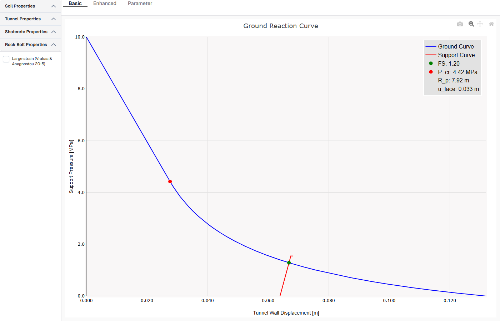
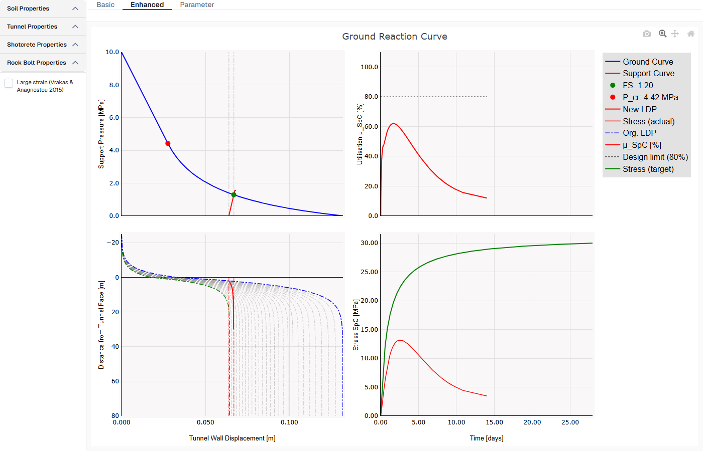
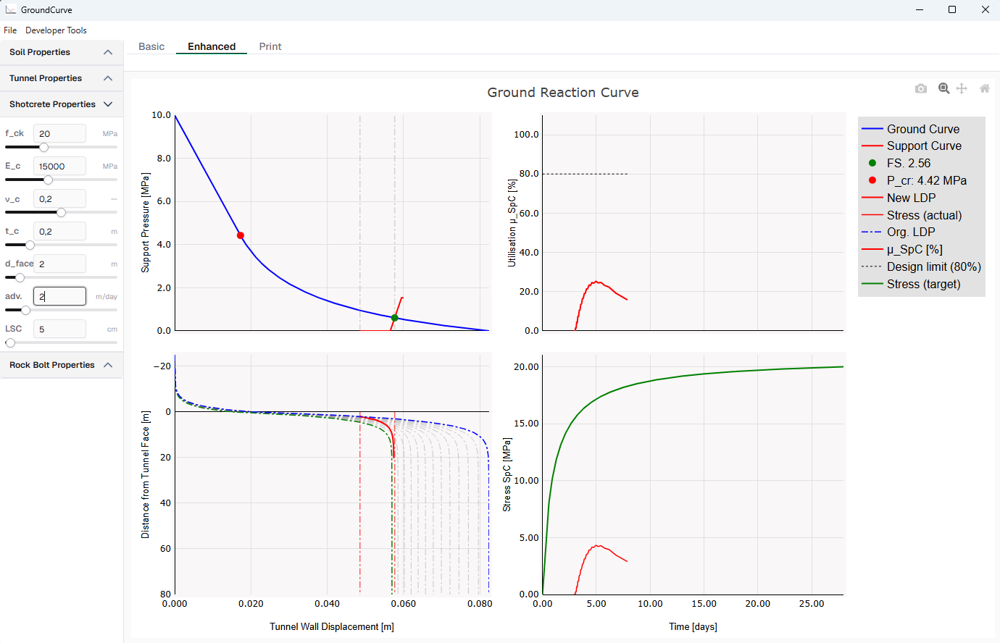

# GroundCurve — Tunnel Ground Reaction Analysis (JavaScript)

**▶ Live app: [https://groundcurve.onurkoc.net](https://groundcurve.onurkoc.net)** — version 2.0.0

A web application for analytical pre-design of tunnel support using the **Convergence-Confinement Method (CCM)**. This is the JavaScript reimplementation of the original Python version. It runs entirely in the browser (static site, hosted on Cloudflare Pages); no installation is needed.

## ⬇️ Last desktop version v1.8.1

**[GroundCurve-win32-x64.zip](https://github.com/onurkoc/ground-curve-JS/releases/download/v1.8.1/GroundCurve-win32-x64.zip)** — last desktop (Electron) release, Windows x64, no installation required. Extract and run `GroundCurve.exe`. The desktop version is no longer developed; new features are only added to the web app. It does not contain the fixes of 2.0.0 (see [Change Log](Change%20Log.txt)), e.g. the LDP correction under support pressure.

---

## Screenshots

### Basic Tab — Ground Reaction Curve


### Enhanced Tab — Full CCM Dashboard


### Enhanced Tab — With LSC Yield Element (desktop v1.8.1)


---

## Features

- **Ground Reaction Curve (GRC)** — Mohr-Coulomb elasto-plastic solution (Hoek / Duncan-Fama formulation)
- **Large strain (optional display)** — sidebar checkbox *Large strain (Vrakas & Anagnostou 2015)* overlays the large-strain ground curve in the Basic and Enhanced charts. Display only: equilibrium, FS and LDP are always computed with the small-strain solution.
- **Longitudinal Displacement Profile (LDP)** — Vlachopoulos & Diederichs (2009)
- **Support Characteristic Curve (SCC)** — thick-walled cylinder shotcrete + rock bolt stiffness (Hoek).
  Shotcrete and bolts are linear-elastic / ideal-plastic (Hoek, Fig. 8 and 14): after p_max each keeps
  p_max on a horizontal plateau, without limit (drawn to the end of the ground curve). This holds for
  shotcrete or bolts alone, for both together and with LSC (shotcrete plateau after the last rise).
  Shotcrete and bolt curves are added at equal displacement (Gschwandtner Eq. V-50), each with its own
  plateau; the total curve is piecewise linear up to the sum of all p_max and horizontal after that.
  RocSupport combines supports differently – combined results are not comparable. For a single support on
  its plateau RocSupport gives the same u_eq but FS = p_max / p at the extended elastic line (e.g. 0.64
  instead of 1.00).
  *No equilibrium – support capacity insufficient* (FS "–") only if the ground curve lies above the
  total curve over its whole length.
  (Replaces the rule of 2026-10-21 "shotcrete reaching p_max is treated as failure".)
- **LSC (Lining Stress Controller) support, single stage** — after Gschwandtner (2010). Inputs:
  - `LSC` = yield path of the element l_yield [cm], tangential (sum over the ring); radial u_gap = l_yield / 2π
  - `LSC force` (F_LSC) = ring force carried by the yielding element [kN per m tunnel], default 0
    (0 = open slot without load, previous behaviour). Both fields have this help text in the sidebar.
    Support pressure on the plateau p_LSC = F_LSC / r_m with r_m = D/2 − t_c/2 (Anhang D, Gl. 2-10 D)

  Shotcrete curve: elastic rise to p_LSC → constant p_LSC over u_gap → elastic rise to p_max,SpC.
  F_LSC = 0 gives the open-slot model (zero shotcrete pressure until the gap is closed).
  The LSC yields only if p_LSC < p_max,SpC (shotcrete capacity alone).
  Bolts act independently of the yield path: shotcrete and bolt curves both start at u_io and their
  pressures are added at equal displacement (Gschwandtner Gl. V-50, Abb. V-51); the components are drawn
  dotted (also without LSC when shotcrete and bolts act together).
  Legend: *FS (total)* = p_max,total / p_eq with p_max,total = sum of all p_max (Hoek Eq. 13), shown in red
  below 1.35 (γ_F, as the 80 % limit of μ_SpC; display only), *FS (shotcrete)* = p_max,SpC / p_SpC(u_eq)
  (on the LSC plateau p_max,SpC / p_LSC), *bolt utilisation* = p_bolt(u_eq) / p_max,bolt,
  *shotcrete yielding* / *bolts yielding* when a component is on its plateau at the equilibrium and, on the
  LSC plateau, the *remaining yield path* (tangential, mm). Background and test values: [docs/LSC-Analyse.md](docs/LSC-Analyse.md)

  Note: FS comes from the 28-day elastic support curve; σ(t) and μ_SpC come from the rate-of-flow method.
  The start and end of the yield path can differ between both (the young shell is softer than the 28-day
  stiffness K_SpC, so σ(t) reaches σ_N later than u_lsc = u_io + p_LSC / K_SpC).
- **Rate-of-Flow stress model** — time-dependent shotcrete stress accounting for creep, shrinkage and thermal effects (Schubert 1988, Aldrian 1991).
  Creep, shrinkage and temperature strain after Entfellner (2024), Kap. 6.4.4.3, Gl. 6.14–6.17 and Tab. 6.4
  (checked against Abb. 6.16). The temperature strain acts only for a concrete age up to 96 h and stays
  constant afterwards; its angle is taken in degrees (reproduces Abb. 6.16 d). Strength and stiffness in time
  follow Aldrian, the age at initial loading t1 (Entfellner Gl. 6.18) is 0.
  With F_LSC > 0 (force-controlled): rate of flow from 0 until σ(t) reaches σ_N = F_LSC / t_c, then constant
  σ_N over the yield path u_gap (Gschwandtner S. 56); rate of flow then continues from σ_N, with creep,
  shrinkage and thermal terms counted from the start of loading. Start and end of yielding are found in the
  time series and can differ from the 28-day support curve used for FS (see the note under LSC)
- **Shotcrete utilisation μ_SpC(t)** — σ_actual(t) / σ_capacity(t) × 100 %, with 80 % design limit (γ_F = 1/1.35).
  Values above 100 % indicate overload; the rate-of-flow method does not limit stress to strength.
  Above 100 %: red dashed line and shaded band
- **Safety factor FS** — at GRC ∩ SCC equilibrium (all support-curve segments including the plateaus are searched, so FS > 10 is found as well)
- **Basic legend** — R_p, u_face (displacement at the face), u_support (at support installation, u_io),
  u_final (at the equilibrium, u_eq) in mm and p_eq (mobilised support pressure) in MPa, as in the RocSupport
  output; "–" when there is no equilibrium. Hovering the equilibrium point shows u_eq, p_eq and FS in full
  (hover names are never cut)
- **Parameter tab** — summary of all 20 input parameters with units
- **Phone layout** (≤ 768 px) — parameter sidebar behind a *Parameters* button, full-width charts, results box (FS, displacements, p_eq, P_cr, R_p) above the first chart, legend with the curve names below the chart, no mode bar; the Enhanced tab stacks its four plots and scrolls

## Inputs

Sidebar label (full name as tooltip and in the Parameter tab):

| Sidebar | Name | Unit |
|---|---|---|
| γ, H, ν, E, c, φ | Unit weight, overburden, Poisson's ratio, rock mass modulus, cohesion, friction angle | kN/m³, m, –, MPa, kPa, ° |
| Dia. | Tunnel Diameter | m |
| f_ck, E_c, ν_c, t_c | SpC Strength, SpC Elasticity, SpC Poisson's Ratio, SpC Thickness | MPa, MPa, –, m |
| d_face | Installation distance from face | m |
| adv. | Advance Rate | m/day |
| LSC, LSC force | LSC Yield (yield path, tangential), LSC Force (ring force F_LSC) | cm, kN/m |
| T_bf | Bolt Pull-out Force | kN |
| S_l | Bolt Longitudinal Spacing | m |
| S_c | Bolt Circumferential Spacing (s_c after Hoek) | m |
| d_b, L_b | Bolt Diameter, Bolt Length | m |

---

## Tech Stack

| Layer | Library |
|---|---|
| UI framework | Vue 3 + PrimeVue 4 (Aura theme) |
| Charts | Plotly.js (cartesian bundle) |
| Build | Vite 5 (static output in `dist/`) |
| Tests | Node.js built-in test runner (`node --test`) |
| Hosting | Cloudflare Pages (see [DEPLOY.md](DEPLOY.md)) |
| Font | Geist |

---

## Installation

Requires Node.js 20 or newer.

```bash
npm install
```

## Development

```bash
npm run dev        # Vite dev server with hot reload
```

## Build and preview

```bash
npm run build      # static site in dist/
npm run preview    # serve dist/ locally
```

## Tests

```bash
npm run test
```

Runs the verification cases against published values (Hoek *Rock-Support Interaction*, RocSupport Verification Manual Problem 5, Gschwandtner Anhang B for the LSC force, Entfellner Abb. 6.16 for the rheological functions) and the golden regression baseline in `tests/golden/` (regenerate deliberately with `UPDATE_GOLDEN=1 npm run test`).

**Validation against RocSupport v4.005** (Duncan-Fama, dilation 0, LDP Vlachopoulos & Diederichs 2009; input and output in `references/RocSupport/Nr.1–3/Dilatation_Null`), `tests/rocsupport_onur.test.js`. All values agree within the rounding of the RocSupport output:

| Case | Input | Checked |
|---|---|---|
| 1 | D 10 m, γ 20, H 350, E 1800 MPa, ν 0.3, c 1500 kPa, φ 23°, d_face 5 m; shotcrete t_c 0.3 m, f_ck 35, E_c 30000 MPa | u unsupported 42.65 mm, u_face 11.2 mm, u_io 30.39 mm, r_p 7.96 m, p_cr 2.88, p_max 2.037, u_eq 31.96 mm, p_eq 0.61 MPa, FS 3.35 |
| 2 | as 1, bolts only: T_bf 354 kN, 1 × 1 m, d_b 34 mm, l_b 3 m | p_max 0.354, u_eq 35.95 mm, p_eq 0.35 MPa, FS 1.02 |
| 3 | D 8 m, γ 20, H 500, E 1050 MPa, ν 0.3, c 1000 kPa, φ 28°, d_face 2 m; shotcrete t_c 0.2 m, f_ck 30, E_c 31000 MPa | u_face 32.66 mm, u_io 63.94 mm, r_p 7.92 m, p_max 1.463, u_eq 67.03 mm, p_eq 1.28 MPa, FS 1.14 |

The app uses the Duncan-Fama solution without dilation (ψ = 0). RocSupport with dilation ψ > 0 gives larger displacements, so only the dilation-0 runs are comparable.

---

## Physics References

| Method | Reference |
|---|---|
| CCM (GRC), support curves | Hoek, E. (2007). *Practical Rock Engineering*, chapter "Rock-Support Interaction analysis for tunnels in weak rock masses" |
| Plastic radius check | Rocscience. *RocSupport Verification Manual*, Problem 5 (Duncan-Fama) |
| Large-strain correction | Vrakas, A. & Anagnostou, G. (2015). A simple equation for obtaining finite strain solutions from small strain analyses of tunnels with very large convergences. *Géotechnique* 65(11), 936–944 |
| LDP | Vlachopoulos, N. & Diederichs, M.S. (2009). Improved longitudinal displacement profiles for convergence confinement analysis of deep tunnels. *Rock Mechanics and Rock Engineering* 42(2), 131–146 |
| Lining forces | Möller, S.C. & Vermeer, P.A. (2005). Prediction of settlements and structural forces in linings due to tunnelling. Proc. 5th Int. Conf. of TC28 of the ISSMGE, Amsterdam |
| Shotcrete strength and stiffness (time) | Aldrian, W. (1991). *Beitrag zum Materialverhalten von früh belastetem Spritzbeton*. Dissertation |
| Rate-of-Flow / utilisation | Schubert, P. (1988). Beitrag zum rheologischen Verhalten von Spritzbeton. *Felsbau* 6(3), 150–153; implementation after Entfellner, M. (2024), Dissertation TU Graz, Chp. 6 |
| LSC (yielding elements) | Gschwandtner, G. G. (2010). Masterarbeit, Montanuniversität Leoben, Kap. V-4.1.5 (Stauchelemente), V-4.3, Anhang B, Anhang D Gl. 2-10 D (p_i = F / r_m) |

---

## Credits

Used works & special thanks to:

- **Gunter Gernot Gschwandtner** — MSc thesis
- **Manuel Entfellner** — MSc & PhD thesis
- **Nedim Radoncic** — PhD thesis

---

## License

[MIT](LICENSE) — © 2025 Onur Koc
